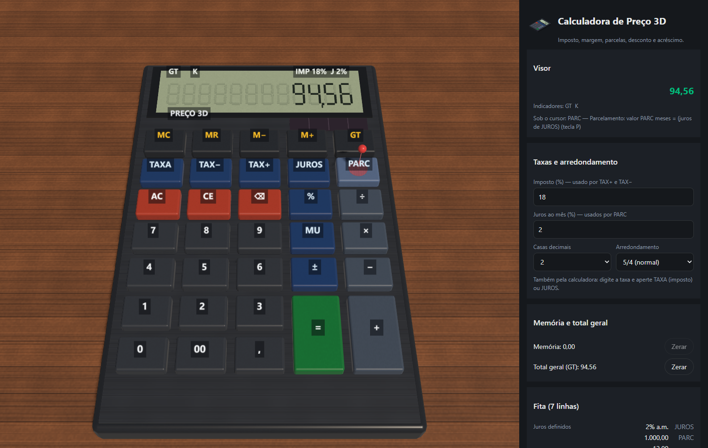
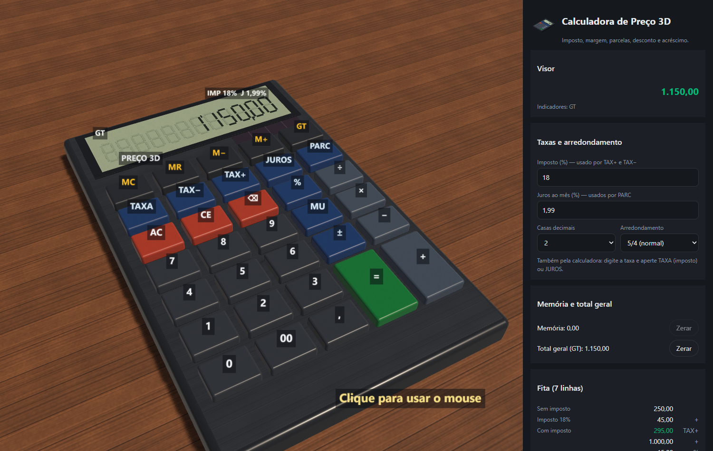

# Calculadora de Preço 3D

Uma calculadora de preços que é, ela mesma, um objeto em três dimensões: uma
calculadora de mesa sobre uma mesa de madeira, com visor de cristal líquido de
sete segmentos e 33 teclas de verdade, que afundam quando apertadas — pelo
mouse, apontando na própria calculadora, ou pelo teclado do computador. Escrita
inteiramente em [Hive](.hivedocs/README.md), com `hive.ui.scene` para o 3D.

Faz as contas de uma calculadora comercial: imposto (TAX+, TAX−, TAXA), preço
pela margem (MU), parcelamento com juros pela tabela Price (PARC, JUROS),
acréscimo e desconto em porcentagem, memória, total geral (GT), casas decimais
e arredondamento à escolha, e uma fita que anota cada passo.





## Requisitos

| precisa de | para quê |
| --- | --- |
| o compilador **Hive** (`hive`) no `PATH` | tudo; o projeto foi feito com a v0.2.7 |
| **Go 1.24+** no `PATH` | `hive run`, `hive build` e `hive test` (`hive check` não precisa) |
| rede, **só na primeira compilação** | o Hive baixa uma versão fixa do three.js para desenhar a cena e a guarda em `~/.hive` |
| um navegador, de preferência da família Chromium (Edge, Chrome) | a janela com cena 3D é desenhada por ele, em modo aplicativo (sem barra de endereço, com perfil próprio); sem Chromium, ela abre numa aba comum |

## Rodando

Na raiz do projeto:

```sh
hive run calculadora.hive
```

Com `HIVE_WINDOW=print`, o programa imprime a URL da janela em vez de abri-la,
para abrir em qualquer navegador.

### Usando

**Mouse.** Clique na calculadora para ela pegar o mouse. Mover o mouse desliza
um cursor vermelho pela face da calculadora, e a tecla debaixo dele sobe e
clareia. O clique esquerdo aperta a tecla, que afunda enquanto o botão estiver
seguro. Segurar o botão direito e mover gira a câmera. Esc devolve o mouse.

**Teclado do computador.** A tecla da calculadora correspondente afunda enquanto
a do computador está segura.

| tecla | faz | tecla | faz |
| --- | --- | --- | --- |
| `0`–`9` | dígitos | `T` | TAX+ |
| `,` ou `.` | vírgula | `Y` | TAX− |
| `+` `-` `*` (ou `x`) `/` | operações | `I` | TAXA |
| `Enter` ou `=` | resultado | `J` | JUROS |
| `%` | porcentagem | `U` | MU |
| `Backspace` | apaga um dígito | `P` | PARC |
| `Delete` | CE | `M` / `K` | M+ / M− |
| `C` | AC | `R` / `L` | MR / MC |
| `N` | ± | `G` | GT |
| setas | giram a câmera | `Page Up` / `Page Down` | aproximam / afastam |
| `Home` | vista padrão | | |

**Painel lateral.** Repete o visor em texto (inclusive para leitores de tela) e
mostra o que faz a tecla sob o cursor. Ali também ficam as taxas de imposto e
juros, as casas decimais (livre, 0 a 4) e o arredondamento (5/4, para cima,
para baixo); a memória e o GT, com botões para zerar; a fita, que se copia,
salva em `.txt` ou limpa; e a câmera, com "girar sozinha" e o som das teclas.

### As contas

A execução é imediata, como numa calculadora de mesa: `2 + 3 × 4 =` dá 20.
O visor tem 12 dígitos, e cada resultado é arredondado para as casas
escolhidas antes de seguir adiante, então o valor que você vê é o valor usado na
conta seguinte.

| exemplo | resultado | |
| --- | --- | --- |
| `200 + 10 %` | 220,00 | acréscimo |
| `200 − 15 %` | 170,00 | desconto |
| `200 × 10 %` | 20,00 | 10% de 200 |
| `50 ÷ 200 %` | 25,00 | quanto 50 é de 200 |
| `100 TAX+` | 118,00 | soma o imposto (18% de fábrica) |
| `118 TAX−` | 100,00 | tira o imposto embutido |
| `12 TAXA` | | define o imposto em 12% |
| `100 MU 25 =` | 133,33 | preço com 25% de margem sobre o preço |
| `2 JUROS 1000 PARC 12 =` | 94,56 | parcela de 1.000 em 12× a 2% a.m. (a fita mostra total e juros) |
| `2 × 3 = = =` | 6, 18, 54 | `=` de novo repete a última operação |
| `100 M+ 30 M− MR` | 70,00 | memória |
| `AC AC` | | o segundo AC seguido zera o GT |

Divisão por zero, estouro dos 12 dígitos e taxas fora da faixa acendem "Erro"
no visor, e daí só AC e CE saem.

## Testes

```sh
hive test testes.hive
```

São 56 testes, todos em `testes.hive`, com cobertura de cerca de 90%. O que
fica de fora são os `main`, o embrulho `update` que só a janela chama e a
leitura das variáveis de ambiente. `hive test` termina com código diferente de
zero se algum teste falhar.

Eles cobrem:

- **O motor:** dígitos, os quatro operadores, `%` em cada operador, `=`
  repetido, TAX±, TAXA, JUROS, MU, PARC (comparado com a tabela Price), memória,
  GT, erros, os três arredondamentos, as casas, e o limite de 500 linhas da fita.
- **O teclado:** as 33 teclas cobrem a grade de 5 × 7 sem sobreposição; o
  centro de cada tecla é dela e o vão entre teclas não é de nenhuma; cada atalho
  do computador faz o mesmo que a tecla.
- **A cena:** os segmentos de cada caractere, o alinhamento do visor, o número
  de formas, as teclas que afundam. O olho sempre mira o centro da calculadora,
  conferido contra a mesma conta de direção que o runtime do Hive usa.
- **O disco:** ida e volta do estado, arquivo corrompido, valores fora da faixa,
  exportação da fita.
- **A janela:** o fluxo do mouse (pegar, apontar, apertar, soltar), o teclado,
  a câmera, o painel, o que vai para o disco, e o que a `view` desenha (via
  `ui.html`).
- **O ícone:** CRC-32 e Adler-32 contra valores de referência, o fluxo zlib e o
  cabeçalho do PNG.

Depois de editar, o comando rápido é o `check`, que roda todas as passagens do
compilador sem chamar o Go:

```sh
hive check calculadora.hive
hive check testes.hive
```

## Compilando

```sh
hive build calculadora.hive    # → calculadora.exe (Windows) / calculadora
```

O executável fica ao lado do arquivo-fonte e o projeto Go gerado vai para
`calculadora.hive-build/`; os dois estão no `.gitignore`. O ícone
`assets/icon.png` é embutido no executável sem configuração nenhuma: o Hive
procura esse caminho por convenção.

Para outra plataforma, use `--target <sistema>/<arquitetura>`; a lista é a de
`go tool dist list`. O nome do executável ganha a plataforma:

```sh
hive build calculadora.hive --target linux/amd64     # → calculadora-linux-amd64
```

## Onde ficam os dados

Taxas, casas, arredondamento, memória, GT, a fita (as últimas 500 linhas), a
posição da câmera e as preferências ficam num `estado.json`. As fitas salvas
vão para a subpasta `fitas/`. O arquivo só é gravado quando algo guardado
muda: mexer o cursor não grava nada.

| sistema | pasta |
| --- | --- |
| Windows | `%APPDATA%\CalculadoraPreco3D\` |
| Linux / macOS | `~/.calculadora-preco-3d/` |
| qualquer um | o que estiver em `CALC3D_DADOS` (no ambiente ou num `.env`) |

Para desenvolver sem mexer nos seus dados, aponte para outra pasta:

```sh
CALC3D_DADOS=./dados-dev hive run calculadora.hive              # bash
$env:CALC3D_DADOS = ".\dados-dev"; hive run calculadora.hive    # PowerShell
```

O formato do arquivo é a declaração de `Salvo` em `lib/estado.hive` e nada mais:
`encode` e `Salvo.decode` são derivados dela pelo compilador. A gravação vai
primeiro para um temporário, que depois é movido para o lugar. Um arquivo que
não se consegue ler é copiado para `estado.json.invalido-<instante>`, e a
calculadora abre com o estado de fábrica.

## Demonstração e capturas de tela

`CALC3D_DEMO` aplica um roteiro de teclas ao abrir, a partir do estado de
fábrica e numa pasta própria (`<dados>/demonstracao`), sem tocar no estado
guardado. O roteiro usa os nomes do teclado do computador separados por espaço,
mais duas palavras próprias:

- `@mirar` mostra o cursor;
- `@sobre:ROTULO` põe o cursor sobre a tecla com aquele rótulo.

```sh
CALC3D_DEMO="2 j 1 0 0 0 p 1 2 enter @mirar @sobre:PARC" hive run calculadora.hive
```

As imagens de `docs/` saíram assim. Primeiro, a janela em modo página:

```sh
CALC3D_DEMO="..." HIVE_WINDOW=print ./calculadora.exe     # imprime: hive-window <url>
```

Depois, a URL fotografada num Chrome headless com WebGL por software:

```sh
chrome --headless=new --use-angle=swiftshader --enable-unsafe-swiftshader \
  --window-size=1500,950 --virtual-time-budget=15000 --screenshot=docs/calculadora.png "<url>"
```

## Estrutura

```
calculadora.hive        a janela: Modelo, Msg, view (func), processar/update (proc),
                        o roteiro de demonstração e o main
testes.hive             todos os testes
lib/
  maquina.hive          o motor: Acao → Maquina → Maquina, o visor e a fita;
                        não sabe nada de janela, de disco ou de 3D
  teclado.hive          as 33 teclas: rótulo, ação, posição na grade, geometria,
                        a tecla sob um ponto e o mapa do teclado do computador
  cena.hive             a cena 3D: câmera, cursor, cores, visor de 7 segmentos,
                        corpo, teclas e som, tudo como função de um Quadro
  estado.hive           o que se guarda, onde, e como se lê e grava
  formato.hive          números no padrão brasileiro e leitura do que se digita
  marca.hive            a marca isométrica, usada pelo logotipo e pelo ícone
ferramentas/
  icone.hive            gera assets/icon.png, escrevendo o PNG byte a byte em Hive
assets/icon.png         o ícone da janela e do executável
docs/                   as capturas usadas neste README
.hivedocs/              referência da linguagem Hive (gerada por `hive agents`)
```

### Como as peças se encaixam

- **O motor é puro.** `maquina.pressionar(m, acao)` devolve uma máquina nova, e
  é só isso que uma tecla faz, venha ela do mouse, do teclado ou dos testes. As
  ações são uma união (`Acao`), e cada `switch` sobre ela precisa cobrir todas,
  então o compilador não deixa uma tecla sem comportamento, atalho ou descrição.
- **A geometria das teclas tem um lugar só.** `teclado.centroX`, `centroZ` e
  `fundo` servem para desenhar a tecla e para saber qual tecla está sob o
  cursor, de modo que o que se vê e o que se aperta nunca divergem.
- **A cena é uma `func` do estado.** `cena.formas(quadro)` devolve as cerca de
  170 formas do quadro atual; nada é guardado de um quadro para outro. O relógio
  da cena (`onFrame`) só é pedido enquanto "girar sozinha" está ligado, então
  uma calculadora parada não redesenha nada.
- **Por que o visor é feito de caixas.** Um `label` de cena tem altura fixa
  (0,42 m) e sempre vem sobre uma plaqueta escura, o que serve para as legendas
  das teclas mas não para os dígitos. Por isso cada dígito são 7 segmentos de
  `box`, acesos ou "fantasmas", como num LCD de verdade.
- **O mouse.** Com `grab(true)`, clicar na cena prende o ponteiro e `onLook`
  passa a informar o deslocamento. `cena.moverCursor` converte esse deslocamento
  em movimento sobre a mesa, levando em conta o giro da câmera. Os botões do
  mouse chegam pelo `onKeyDown` como `mouse1` (esquerdo) e `mouse3` (direito).
- **O layout.** A fileira cena + painel usa `height(0)` com `grow(1)`, para que
  a cena tenha a altura da janela e o painel, mais alto, role por dentro.

### Acrescentando uma tecla

1. Acrescente a variante em `maquina.Acao`.
2. Rode `hive check calculadora.hive`: o compilador aponta cada `switch` que
   precisa dela (`pressionar`, `teclado.atalho`, `teclado.descricao`).
3. Implemente o comportamento no motor.
4. Ponha a tecla em `teclado.teclas()`. Se a grade mudar de 5 × 7, ajuste o teste
   da grade, que garante que nenhuma posição fique vazia ou dupla.
5. Se quiser um atalho, acrescente-o em `teclado.acaoDoTeclado`.
6. Escreva os testes em `testes.hive`.

## Ferramentas

```sh
hive run ferramentas/icone.hive     # regera assets/icon.png
```

O gerador rasteriza a marca de `lib/marca.hive` com supersampling 4×4 e escreve
o PNG inteiro em Hive: assinatura, `IHDR`, um fluxo zlib com blocos "stored",
CRC-32 e Adler-32.
